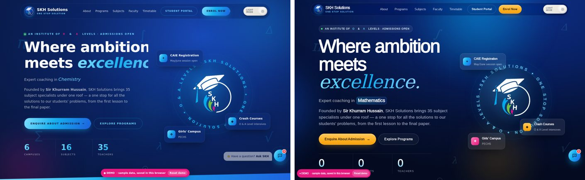
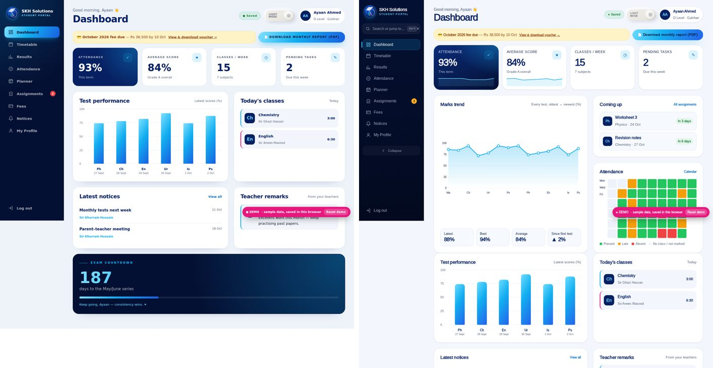
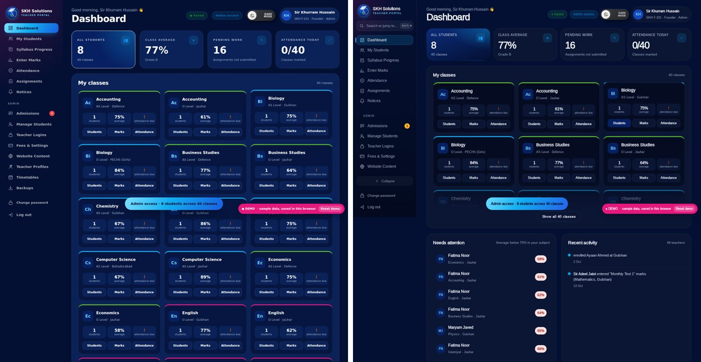
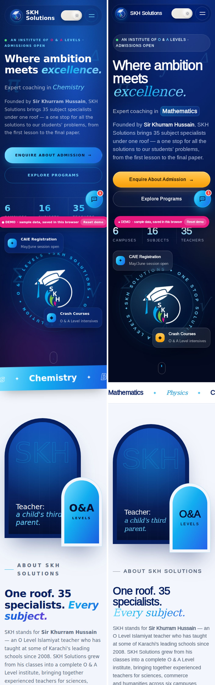

# Redesign: design system v2, a reworked marketing site and new app shells for both portals

**Branch:** `redesign/v2`. Paste this as the PR description when you push it; I couldn't push it myself because the repo isn't connected to this session.

## What changed

All of this is additive. The existing markup, IDs, `data-view` / `data-v` / `data-tab` attributes, form IDs and the classes the JS uses are unchanged. The new layers load after the old CSS and JS:

| File | Role |
|---|---|
| `css/ds.css` | Design tokens for light and dark, including `prefers-color-scheme` handling. Also: fonts with metric-matched fallbacks, a fluid type scale, a 4/8 spacing grid, radius, shadow, blur, z-index and motion tokens (150/250/400/700 ms plus named easings and a spring), and shared components: buttons (with a loading state), inputs, tabs, badges, cards, tooltips, skeletons, avatars, progress rings, sparklines, the confirm dialog, keyboard-key chips and the focus ring. It also holds the reduced-motion policy and the cross-page view transitions. |
| `css/site.css` | Marketing site: aurora hero, glass header, full-screen mobile menu, bento spotlight, faculty filters, pinned "How to join" scrollytelling, multi-step form, FAQ height animation and the spring chat panel |
| `css/app.css` | Portals: split-screen login with an animated role toggle, and an app shell that is a collapsible sidebar on desktop, an icon rail on tablets and a tab bar on phones. Also the command palette, charts, sticky and sortable tables (shown as cards on phones), the parent banner, the QR ID card and scanner feedback |
| `js/motion.js` | Site behaviour: aurora (paused while off-screen), magnetic CTAs, mobile menu focus and Esc, view-transition wrappers, faculty subject/campus filter with an animated reflow, and a card-to-modal morph. Also the scrollytelling, the 3-step admissions form with inline validation, a progress bar and a checkmark with light confetti |
| `js/app-ux.js` | Portal behaviour: wraps the global `show()` and `initApp()`. Adds Ctrl/⌘ K, KPI tickers and sparklines, a marks trend line, an attendance heatmap, "Coming up", sortable tables, the custom confirm dialog for every "click twice" button, QR scan feedback, the theme-colour meta tag and a "show all classes" clamp on the admin dashboard |
| `vercel.json` | Static deploy with security and cache headers. With no backend, the site falls back to demo mode as before |
| `site.webmanifest`, `assets/favicon-*`, `apple-touch-icon.png`, `icon-192/512.png`, `og-image.jpg`, `skh-emblem-300.webp`, `skh-emblem-96.png` | Favicon set, PWA manifest, social card and lighter logo images |

Small edits to existing files:

- **`script.js`**
  - The loader now finishes in under 0.9 s and is skipped on repeat visits.
  - The hero count-up shows the final number straight away for reduced-motion users.
- **`server.js`**
  - Adds MIME types for `.webmanifest`, `.json` and `.woff2`.
- **The three HTML heads**
  - The new fonts load asynchronously.
  - The theme falls back to the system light/dark setting.
  - Added: meta description, Open Graph and Twitter cards, JSON-LD `EducationalOrganization` with all 6 campuses, favicons and the manifest.
  - The portals are `noindex`.
- **`index.html`**
  - A skip link and `<main id="main">`.

No content was invented. Campuses, phone numbers, emails, subjects, teachers and the founder's story come from the existing files. Results and testimonials still come only from the admin's **Website Content** page.

## Design decisions

- **Type:** Bricolage Grotesque (variable, optical size) for display, Inter for UI, and Instrument Serif italic for the accent words. All load from Google Fonts with metric-matched local fallbacks to avoid layout shift.
- **Colour:** brand navy and sky blue from the logo. One warm marigold (`--cta`) is used only on conversion buttons: Enquire, Enrol Now, Continue / Send enquiry and Start Preparing. Pink is kept for the girls' campus and the founder badge.
- **Variable-weight animation:** dropped on purpose. Animating `font-weight` triggers layout, which breaks hard rule 6, so the headline uses a word-mask reveal (transform only) instead.
- **Campus filter on the faculty grid:** uses the same `teacherAt()` assignment the campus section already shows. An admin-set `campusList` overrides it. The note under the grid says campus assignments are confirmed at admission.
- **"How to join":** keeps SKH's real 4 steps rather than inventing an "assessment" step.

## Improvement log (rounds)

Scores are my own 1–10 ratings on 8 criteria: first impression, hierarchy, brand fit, motion quality, mobile, accessibility, performance and trust.

| Round | Area | Critique | Change | Min score |
|---|---|---|---|---|
| 0 | Baseline | Montserrat everywhere, content hidden until JS ran, 1.4 s loader, no system dark mode, no SEO | — | 6 |
| 1 | Tokens + site | Scroll-driven reveals blank in full-page captures; can't QA the static version | Separate static (reduced-motion) and motion captures; reveals now degrade to visible | 7.5 |
| 2 | Hero / faculty / join | Headline tracking too tight; 35 teachers took about 3 screens; scrolly steps were centred cards | Tracking −0.035em; denser 150px grid; horizontal step cards with a progress rail and counter | 8.5 |
| 2 | Student dashboard | Trend chart panel was half empty | Trend panel stretches beside a "Coming up" + heatmap stack, with Latest / Best / Average / Change stats | 9 |
| 2 | Admin dashboard | 40 class cards made a page about 7 screens long | Clamped to 2 rows with "Show all 40 classes" | 9 |
| 3 | Mobile | Faculty department tabs wrapped onto 3 rows; demo badge covered CTAs; 35 cards in 2 columns | Tabs scroll horizontally; demo badge is a compact corner chip; 3-up grid showing 9 teachers first, then "Show all" | 9.5 |
| 3 | Heatmap on tablet | Cells stretched to about 60px | Columns capped at 12–20px; weeks counted from the join date (8–16) | 9.5 |
| 4 | Performance | LCP was 3.8 s on mobile (4G + 4× CPU) because the hero waited for JS and the `load` event | Hero entrance runs on CSS time; fonts load without blocking render; emblem is now 32 KB WebP with `fetchpriority` | 9.5 |

## QA

All checks ran headless in Chromium.

| Check | Result |
|---|---|
| Website, top to bottom, at 375 / 768 / 1440 in light and dark (motion and reduced motion) | Zero console errors |
| Horizontal overflow at 360 / 768 / 1920 on every page and every portal view | None |
| Admin SKH-T-101 | All **15** sections |
| Teacher SKH-T-108 | All 7 sections |
| Student SKH-2026-0101 | All **9** sections |
| Parent | Logs in; read-only banner shows |
| ⌘K palette | "fees" + Enter opens Fees |
| Confirm dialog | Opens from "Reset demo" |
| Enquiry form | Step validation works; on success it shows the checkmark and confetti |
| Faculty filter | Campus filter works |
| Modal | Teacher profile modal opens |
| Mobile menu | Opens and closes |
| Server mode (`node server.js`) | The enquiry is POSTed to `/api/enquiries` and shows up in **Admissions** for the admin. Demo mode is still detected when there is no server |
| Performance, local server, 4G + 4× CPU throttle | Mobile LCP **0.62 s**, CLS 0.018. Desktop LCP **1.86 s**, CLS 0 |
| Lighthouse | Not run, because the sandbox can't install it. Run `npx lighthouse http://localhost:3000 --view` before merging |
| Reduced motion | Static version: everything visible, no loader, no aurora, counters show final values |

## Before / after

## Notes for reviewers

- Screenshots were taken offline, so they show the fallback fonts. Real visitors get Bricolage, Inter and Instrument Serif.
- Windows "Animation effects: off" makes the browser report `prefers-reduced-motion: reduce`, so on that machine you will see the static version. Turn animations on to see the motion.
